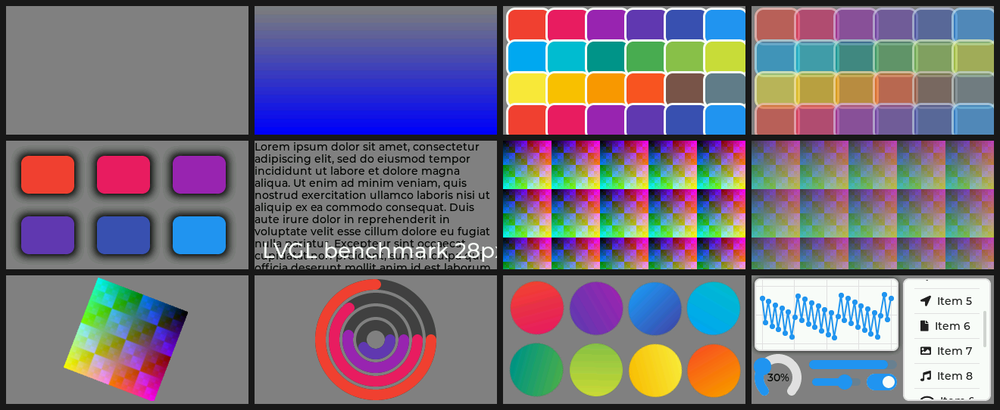

# LVGL 8.4 × 9.6 no ESP32-S3 (LilyGO T-Display-S3)

O LVGL 9 trouxe um pipeline de desenho novo e várias otimizações. Este projeto mede **o quanto isso
muda na prática** num ESP32-S3 de verdade: o mesmo código de interface roda nas duas versões, na
mesma placa, com as mesmas configurações, e o tempo de cada quadro vai para o PC pela USB.



*Da esquerda para a direita, de cima para baixo: `fill`, `gradient`, `rects`, `rects_opa`, `shadow`,
`text`, `image`, `image_opa`, `rotate`, `arc`, `grad_rot`, `ui`.*

## Resumo

- **O v9 é bem mais rápido onde o trabalho é misturar pixels:** texto suavizado (−54%), imagem
  girada (−41%), retângulos translúcidos (−32%) e imagem translúcida (−25%).
- **O v9 é mais lento onde há muitas operações pequenas:** preencher e copiar sem transparência
  (+44% e +64%, mas abaixo de 5 ms), o gráfico da interface `ui` (+36%) e os objetos girados de
  `grad_rot` (+40%). No v9 cada primitiva de desenho (cada segmento de linha, cada ponto do gráfico)
  tem um custo fixo maior.
- **Para uma interface típica com widgets (`ui`), o v8 ainda ganha:** 43 contra 32 FPS com a tela a 40 MHz.
  Para telas cheias de texto, o v9 dobra: 60 contra 29 FPS.
- **Renderizar nos dois núcleos (`LV_DRAW_SW_DRAW_UNIT_CNT=2`) deixou o v9 mais lento em todas as
  cenas** (+13% a +92%). Só ligar o FreeRTOS no LVGL já custa até 29%.
- **Clock do barramento do LCD:** com o valor do exemplo da LilyGO (6,67 MHz) toda cena leve fica
  presa em 60 FPS. A 40 MHz as cenas leves passam de 300 FPS; as pesadas não mudam, porque aí quem
  limita é a CPU.

## Hardware e método

| | |
|---|---|
| Placa | LilyGO T-Display-S3: ESP32-S3 (2 núcleos a 240 MHz), ST7789 320×170 em barramento i80 de 8 bits |
| SDK | ESP-IDF 5.5.4, LVGL 8.4.0 e 9.6.0 pelo registro de componentes |
| Cor | RGB565, dois buffers parciais de 40 linhas em RAM interna com DMA |

Cada cena redesenha **a tela inteira 60 vezes** (`lv_obj_invalidate` + `lv_refr_now`) e o tempo de
cada quadro é medido com `esp_timer`. Cada cena roda em dois modos:

- **render**: o `flush_cb` descarta os pixels. Mede só a CPU desenhando, que é o que muda entre as versões.
- **lcd**: os pixels vão por DMA até a tela. Inclui o barramento, que depende do clock (PCLK).

Para a comparação ser justa, as duas versões usam:

- os mesmos buffers, `malloc`/`memcpy` da libc, `-O2`, caches de instrução e dados no máximo e as
  funções críticas do LVGL em IRAM (`LV_ATTRIBUTE_FAST_MEM_USE_IRAM`);
- troca de bytes do RGB565 feita pelo hardware do LCD (`swap_color_bytes`), sem custo de CPU em nenhuma delas;
- cenas sintéticas sem estilo de tema (`lv_obj_remove_style_all`): os temas padrão do v8 e do v9 são
  diferentes, e assim as duas desenham exatamente a mesma coisa. A exceção é `ui`, que usa o tema
  padrão de propósito, como um app migrado do v8 para o v9.

A única diferença de configuração obrigatória: o v8 com cor de 16 bits precisa de
`LV_COLOR_SCREEN_TRANSP=1` para girar objetos que não são imagem (cena `grad_rot`). Sem isso ele
pula o objeto em silêncio.

Os tempos de cada quadro ficam em RAM durante a medida e só depois saem pela USB nativa do S3, uma
linha CSV por quadro. O `bench.py` captura um ciclo completo, confere se nenhuma linha se perdeu e
grava em `results/`.

## Resultados

### Renderização: v8 × v9


| cena | o que desenha | v8 (ms) | v9 (ms) | v9 vs v8 |
|---|---|---:|---:|---:|
| `fill` | só o fundo da tela | 0,53 | 0,77 | +44% |
| `gradient` | degradê vertical na tela toda | 1,50 | 1,58 | +5% |
| `rects` | 24 retângulos arredondados com borda | 10,11 | 11,40 | +13% |
| `rects_opa` | os mesmos, a 50% de opacidade | 24,45 | 16,67 | −32% |
| `shadow` | 6 retângulos com sombra larga | 27,07 | 24,22 | −11% |
| `text` | parágrafo em 14 px + título em 28 px | 34,35 | 15,70 | −54% |
| `image` | 15 imagens RGB565 de 64×64 | 2,93 | 4,79 | +64% |
| `image_opa` | as mesmas, a 50% de opacidade | 13,70 | 10,28 | −25% |
| `rotate` | imagem ampliada 2× girando | 21,44 | 12,72 | −41% |
| `arc` | 4 arcos concêntricos | 11,30 | 10,45 | −8% |
| `grad_rot` | 8 círculos com degradê girando | 50,73 | 71,07 | +40% |
| `ui` | gráfico, medidor, barra, slider, switch e lista rolando | 21,83 | 29,75 | +36% |

### Por que o v9 perde no `ui`

Para isolar a causa, cada parte da cena `ui` foi medida sozinha, num teste sem janela no PC (x86,
clang `-O2`; os valores absolutos não valem para o S3, só a proporção entre as versões):

| parte da `ui` | v8 | v9 | v9 vs v8 |
|---|---:|---:|---:|
| gráfico (40 pontos) com sombra | 0,138 ms | 0,191 ms | +38% |
| lista com 15 itens rolando | 0,079 ms | 0,096 ms | +22% |
| medidor + rótulo | 0,045 ms | 0,043 ms | −3% |
| barra, slider e switch | 0,023 ms | 0,028 ms | +21% |
| **tela completa** | **0,338 ms** | **0,409 ms** | **+21%** |

O gráfico responde por três quartos da diferença e a lista pelo resto. Variando o número de pontos do
gráfico (10 a 160), cada segmento a mais custa ~2,9 µs no v8 e ~4,1 µs no v9, e cada pontinho mais
~0,8 µs no v9 (no v8 é quase de graça).
No v9 cada primitiva vira uma tarefa de desenho (*draw task*) com custo fixo próprio; isso compensa
quando a primitiva cobre muitos pixels (texto, transparência) e pesa quando são muitas primitivas
pequenas (linhas de gráfico, pontos, camadas pequenas). O mesmo padrão aparece em `fill`, `rects` e `image`.

### Um núcleo × dois núcleos (v9)

O v9 consegue dividir o desenho entre threads (`LV_USE_OS=FREERTOS` + `LV_DRAW_SW_DRAW_UNIT_CNT=2`).
Neste cenário isso piorou tudo. Tempos de renderização em ms:

| cena | v9 | v9 + FreeRTOS | v9 + 2 núcleos |
|---|---:|---:|---:|
| `fill` | 0,77 | 0,87 (+14%) | 1,47 (+92%) |
| `gradient` | 1,58 | 1,68 (+7%) | 2,72 (+73%) |
| `rects` | 11,40 | 14,74 (+29%) | 20,05 (+76%) |
| `rects_opa` | 16,67 | 20,01 (+20%) | 25,31 (+52%) |
| `shadow` | 24,22 | 25,38 (+5%) | 38,19 (+58%) |
| `text` | 15,70 | 16,25 (+3%) | 23,33 (+49%) |
| `image` | 4,79 | 5,47 (+14%) | 9,00 (+88%) |
| `image_opa` | 10,28 | 10,94 (+6%) | 14,48 (+41%) |
| `rotate` | 12,72 | 12,69 (−0%) | 14,35 (+13%) |
| `arc` | 10,45 | 11,73 (+12%) | 17,03 (+63%) |
| `grad_rot` | 71,07 | 71,22 (+0%) | 89,30 (+26%) |
| `ui` | 29,75 | 36,54 (+23%) | 52,06 (+75%) |

A coluna do meio separa o custo de só ligar o OS (tarefas trocadas por sincronização) do custo de
dividir entre os núcleos. A hipótese mais provável é que, com buffers de 40 linhas e muitas
primitivas pequenas, a sincronização entre as threads custa mais do que o segundo núcleo economiza.
Isso não foi investigado a fundo.

### Clock do barramento do LCD


O S3 gera o PCLK como 80 MHz / n, então os valores possíveis são 40, 26,67, 20, 16, 13,33, … e 6,67 MHz
(este é o que o valor do exemplo da LilyGO, 6,528 MHz, vira de fato). Um quadro inteiro tem 108.800
bytes, então o barramento sozinho limita a ~61 FPS a 6,67 MHz e a ~367 FPS a 40 MHz.

<details>
<summary>FPS de todas as cenas em todos os clocks</summary>

LVGL 8.4:

| cena | 6,67 MHz | 10 MHz | 16 MHz | 20 MHz | 26,67 MHz | 40 MHz |
|---|---:|---:|---:|---:|---:|---:|
| `fill` | 60 | 89 | 140 | 172 | 225 | 325 |
| `gradient` | 59 | 87 | 136 | 167 | 215 | 305 |
| `rects` | 55 | 78 | 86 | 89 | 93 | 95 |
| `rects_opa` | 36 | 38 | 40 | 40 | 40 | 40 |
| `shadow` | 34 | 36 | 36 | 36 | 36 | 36 |
| `text` | 28 | 28 | 29 | 29 | 29 | 29 |
| `image` | 58 | 85 | 131 | 160 | 204 | 260 |
| `image_opa` | 51 | 61 | 66 | 68 | 70 | 70 |
| `rotate` | 38 | 41 | 43 | 43 | 44 | 45 |
| `arc` | 54 | 68 | 76 | 78 | 81 | 83 |
| `grad_rot` | 19 | 19 | 19 | 19 | 19 | 19 |
| `ui` | 37 | 40 | 42 | 42 | 43 | 43 |

LVGL 9.6:

| cena | 6,67 MHz | 10 MHz | 16 MHz | 20 MHz | 26,67 MHz | 40 MHz |
|---|---:|---:|---:|---:|---:|---:|
| `fill` | 60 | 88 | 138 | 170 | 221 | 316 |
| `gradient` | 59 | 87 | 135 | 165 | 213 | 299 |
| `rects` | 55 | 72 | 79 | 82 | 84 | 84 |
| `rects_opa` | 49 | 53 | 57 | 58 | 58 | 58 |
| `shadow` | 38 | 39 | 40 | 40 | 40 | 40 |
| `text` | 50 | 58 | 59 | 60 | 60 | 60 |
| `image` | 57 | 83 | 125 | 150 | 169 | 183 |
| `image_opa` | 53 | 75 | 85 | 88 | 91 | 91 |
| `rotate` | 52 | 63 | 68 | 70 | 72 | 73 |
| `arc` | 54 | 72 | 81 | 84 | 87 | 89 |
| `grad_rot` | 14 | 14 | 14 | 14 | 14 | 14 |
| `ui` | 30 | 31 | 32 | 32 | 32 | 32 |

</details>

O ST7789 é especificado para ~15 MHz no modo 8080; acima disso funcionar ou não depende da placa.
Os tempos foram medidos até 40 MHz, mas confira a imagem na sua antes de usar um clock alto num produto.

### Benchmark oficial do LVGL (`lv_demo_benchmark`)

Cada versão traz o seu benchmark, com **cenas e métricas diferentes**: os números de um não se
comparam com os do outro, e é por isso que este projeto tem cenas próprias. Os dois rodaram aqui
com o LCD a 20 e a 40 MHz; os resumos completos estão em `results/*-demo@*.txt`.

**LVGL 8.4** (modo de velocidade máxima, FPS calculado pelo tempo de redesenho da área que mudou):

| | 20 MHz | 40 MHz |
|---|---:|---:|
| Weighted FPS | 449 | 483 |
| Opa. speed | 36% | 35% |
| Text small / large | 37 / 38 | 37 / 38 |
| Shadow large | 34 | 34 |
| Image RGB rotate anti aliased | 91 | 98 |
| Rectangle | 383 | 566 |

As cenas de fonte comprimida deram 0 FPS nas duas medidas (não investigado).

**LVGL 9.6:**

| cena | FPS (20 MHz) | FPS (40 MHz) | render (ms) |
|---|---:|---:|---:|
| Empty screen | 127 | 176 | 4 |
| Moving wallpaper | 717 | 744 | 7 |
| Single rectangle | 984 | 984 | 0 |
| Multiple rectangles | 208 | 208 | 3 |
| Multiple RGB images | 935 | 934 | 1 |
| Multiple ARGB images | 905 | 904 | 2 |
| Rotated ARGB images | 463 | 458 | 10 |
| Multiple labels | 234 | 233 | 3 |
| Screen sized text | 32 | 32 | 31 |
| Multiple arcs | 983 | 983 | 0 |
| Containers | 831 | 829 | 7 |
| Containers with overlay | 60 | 61 | 14 |
| Containers with opa | 790 | 788 | 9 |
| Containers with opa_layer | 675 | 675 | 15 |
| Containers with scrolling | 68 | 69 | 12 |
| Widgets demo | 91 | 91 | 8 |
| **média** | **506** | **510** | **7** |

Os dois quase não mudam de 20 para 40 MHz: as cenas oficiais redesenham áreas pequenas (o v9 mede
0 ms de envio na maioria), então quem limita é a CPU. A coluna "Avg. CPU" do v9 (80–99%) só reflete
o laço de medida, que nunca dorme.

## Como rodar

Você precisa do ESP-IDF 5.5 (testado com o 5.5.4) e de uma T-Display-S3 ligada pela USB-C. Em um
terminal com o ESP-IDF ativado (ele já traz o Python com `pyserial`):

```sh
python bench.py run v9 COM6        # compila, grava, captura e salva results/v9.csv
python bench.py run v8@40 COM6     # mesma coisa com o LCD a 40 MHz
python bench.py compare results/v8.csv results/v9.csv
python docs/charts.py              # refaz os gráficos e imprime as tabelas
```

A porta é opcional (sem ela o `bench.py` procura a USB da Espressif). Variantes:

| variante | o que é |
|---|---|
| `v8`, `v9` | a base da comparação, LVGL sem OS, um núcleo |
| `v9-freertos` | v9 com `LV_USE_OS=FREERTOS` e uma unidade de desenho |
| `v9-mt` | v9 com FreeRTOS e duas unidades de desenho (os dois núcleos) |
| `v8-demo`, `v9-demo` | o `lv_demo_benchmark` oficial de cada versão |
| `…@MHz` | qualquer uma acima com outro clock no LCD, por exemplo `v9-demo@40` |

Cada variante compila em `v8/build-<variante>` ou `v9/build-<variante>`; trocar só o clock recompila
apenas o `main`. Se a placa reiniciar no meio da captura (travamento), o `bench.py` para e mostra o log.

### Simulador no PC

`sim/` roda as mesmas cenas com LVGL 9 e SDL2 numa janela 3× maior, para ver como cada cena deve
ficar na tela. Com `--demo`, roda o `lv_demo_benchmark`. Ele usa o LVGL que o ESP-IDF baixa para
`v9/managed_components`, então compile o `v9` antes. Sem SDL2 instalado, o CMake do LVGL baixa e
compila o SDL2 sozinho.

```sh
# Linux (com libsdl2-dev instalado) ou macOS
cmake -S sim -B sim/build -G Ninja && cmake --build sim/build && sim/build/lvgl_bench_sim

# Windows com LLVM (clang) e Visual Studio Build Tools
cmake -S sim -B sim/build -G Ninja -DCMAKE_C_COMPILER=clang -DCMAKE_CXX_COMPILER=clang++ -DCMAKE_RC_COMPILER=llvm-rc
cmake --build sim/build
sim\build\lvgl_bench_sim.exe --demo
```

## Estrutura

```
bench.c            firmware: driver do LCD, medição e envio pela USB (compila no v8 e no v9)
scenes.c, .h       as 12 cenas, com a API comum às duas versões
bench.py           compilação, gravação, captura e comparação
sdkconfig.common   configuração comum (CPU, caches, console USB, fontes, IRAM)
v8/, v9/           projetos ESP-IDF; cada um puxa a sua versão do LVGL
sim/               simulador no PC (LVGL 9 + SDL2)
results/           dados brutos: um CSV por variante (tempo de cada quadro) e os resumos do benchmark oficial
docs/              gráficos (gerados por charts.py a partir de results/) e a imagem das cenas
```

## Problemas encontrados no caminho

- **Lixo em partes aleatórias da tela.** As T-Display-S3 mais novas vêm com outro lote de tela e
  precisam da sequência de inicialização extra da LilyGO (`LCD_MODULE_CMD_1` nos exemplos deles). Ela
  está em `lilygo_init` no `bench.c`.
- **A USB não aparece ou dá erro 31 / "falha na solicitação de descritor".** Segure BOOT, aperte RST
  e solte BOOT para entrar no modo de gravação; se nem assim aparecer, o cabo é só de carga.
- **O v8 não desenha objetos girados.** Com cor de 16 bits ele precisa de `LV_COLOR_SCREEN_TRANSP=1`;
  sem isso só registra um aviso no log e pula o objeto, e o quadro sai barato demais. Foi um teste
  sem janela no PC, salvando os quadros das duas versões em PNG, que mostrou isso.
- **Estouro de pilha com LVGL + FreeRTOS.** A tarefa `main` do ESP-IDF tem 3,5 KB por padrão, o que
  estoura na cena `ui`; aqui ela tem 16 KB.
- **O PCLK pedido não é o PCLK real.** O driver i80 arredonda o divisor para baixo, então um valor
  entre 26,67 e 40 MHz vira 40 MHz. O `bench.py` já escolhe o 80/n mais próximo.
- **O `lv_demo_benchmark` precisa do tick andando durante o desenho.** Ele mede com o relógio do LVGL;
  com `lv_tick_inc` só entre as chamadas de `lv_timer_handler` os quadros parecem levar 0 ms e o FPS
  explode. Aqui o tick vem de um `esp_timer` de 1 ms.
- No v9.6 o `lv_list` usado na cena `ui` está marcado como obsoleto (funciona, mas gera aviso). No v8 o
  switch da `ui` aparece cinza porque a animação de cor do tema depende do tick, que não anda nas
  cenas medidas; isso não muda o custo do quadro.
